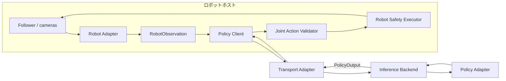

# Universal Robot Policy Inference のアーキテクチャ

## 責務と拡張

| コンポーネント | 責務 |
| --- | --- |
| `RobotAdapter` | 能力、観測の取得、ローカル検証、実行、停止、接続の終了。ロボット固有の並びと単位を定義。 |
| `PolicyClient` | 能力の照合、要求と応答の ID、応答の期限を確認。デフォルトで Dry-run。 |
| `TransportAdapter` | 能力と推論の要求を運ぶ。ローカル呼び出しと認証付き gRPC を実装。 |
| `InferenceBackend` | 観測と能力を確認し、1 ワーカーにつきロード済み Adapter を 1 個保持。前処理、予測、後処理を要求単位で直列化。 |
| `PolicyAdapter` | モデルのロード、特徴の対応付け、公式プロセッサによる変換。物理単位のチャンクを返す。 |
| `resolve_joint_chunk` | 関節名と単位を照合し、絶対位置に変換して連続性、速度、位置範囲を確認。 |

π0.5 は LeRobot の保存済み Pre/Postprocessor と `predict_action_chunk` を呼びます。相対学習のチェックポイントは、公式の Absolute Actions Processor が元の状態から位置を復元します。GR00T N1.7 は NVIDIA の `Gr00tPolicy.get_action` がモダリティの前処理と復元を行います。どちらも共通層には復元済みの絶対関節位置を返します。 [LeRobot の π0.5](https://huggingface.co/docs/lerobot/en/pi05) · [NVIDIA Policy API](https://github.com/NVIDIA/Isaac-GR00T/blob/main/getting_started/policy.md)

新しいポリシーは `PolicyAdapter` の 5 メソッドを実装し、ローカルの信頼済み YAML で `policy.adapter`、`policy.plugin: package.module:Factory`、`policy.capabilities` を指定します。ファクトリーは `PolicyCapabilities` と `policy.options` を受け取ります。組み込みにする場合は `config.py` のレジストリに名前を追加します。ロボット側からは同じプロトコルで `policy.id` を指定します。新しい Robot Adapter も `robot.plugin` 経由で登録できます。ACT、SmolVLA、Diffusion Policy などは同じインターフェイスを利用できます。

## 共通データ

### Observation

- `robot_id` は機体または記録の ID、`robot_type` は対応判定に使うロボット種別です。
- `state` は 1 次元の `float32` ベクトルです。`state_names` が順番を、`state_units` が単位を示します。
- `images` はカメラ名から RGB `uint8` HWC 配列へのマッピングです。カメラ数、解像度、状態次元はプロファイルと入力で決まります。入力解像度の変換は Adapter とその公式プロセッサが担当します。
- `timestamp_ns` は状態取得時刻です。`image_timestamps_ns` はカメラごとの取得時刻です。ライブ入力ではロボットホストの monotonic clock、記録ではデータセット時刻を使います。UVC のライブ画像時刻はホスト取得時刻です。
- `observation_id` は各観測に一意です。`task` は任意の指示文です。`metadata` は JSON のオブジェクトです。

### Action

`actions` は `float32` の `(horizon, action_dim)` です。`action_names` が列順、`action_units` が物理単位を示します。`request_id`、`observation_id`、`policy_id` が相関 ID です。`fps` はチャンクの制御周波数です。`metadata` は JSON のオブジェクトです。

| `action_representation` | 変換 |
| --- | --- |
| `absolute_joint_position` | 各行が絶対目標。 |
| `relative_joint_position` | 各行のオフセットを要求時の同一観測に加算。 |
| `delta_joint_position` | 要求時の観測を起点として、各行のオフセットを順に累積。 |

相対または差分形式で `absolute_features` に挙げた列は絶対目標です。これにより腕を相対表現としながら、グリッパーに独立した単位と範囲を適用できます。Cartesian、EEF、その他の未対応表現は明示的に拒否します。

## Capability negotiation

`GetCapabilities` が返す情報にはプロトコル版、ポリシー ID、対応ロボット種別、必須カメラ、状態とアクションの特徴名と単位、アクション次元、正確なホライズン、制御周波数、表現、絶対列、タスクの要否が含まれます。

クライアントはロボット側の能力と比較して、必要なカメラと状態が取得でき、ロボットのアクション列をポリシーがすべてカバーし、単位・形式・上限が一致するときに要求を送ります。列順は変換できます。能力オブジェクトをキー順に整列した JSON の SHA-256 を `Infer` に入れ、能力の変更があればワーカー側でも拒否します。応答のホライズンと次元は宣言どおりである必要があります。

フィンガープリントは `action_dim` を含む能力情報に対して算出します。Python 実装の正規化形式は `json.dumps(capabilities, sort_keys=True, separators=(",", ":"), ensure_ascii=True, allow_nan=False)` の UTF-8 バイト列です。

## gRPC

Universal Protocol v1 は `lerobot.remote_policy.v1.Policy` の unary RPC を使います。RPC ボディはバイト列として読み書きします。

| RPC | 要求 | 応答 |
| --- | --- | --- |
| `GetCapabilities` | 空のバイト列 | UTF-8 JSON の能力情報 |
| `Infer` | `request_id`、能力フィンガープリント、観測を含む NPZ | `PolicyOutput` の NPZ |

両 RPC に `authorization: Bearer <token>` を付けます。クライアントは接続先の証明書を検証し、`grpc://` はループバックだけ受け付けます。`grpcs://` では、ワーカー設定の `inference.listen`、`tls_certificate`、`tls_key` と、必要に応じてクライアント設定の `endpoint` と `ca_file` を指定します。ファイルはプロファイルからの相対パスを使えます。トークンは `inference.token_env` が指す環境変数から取得します。

ネットワーク要求に gRPC の deadline を設定し、自動再試行は無効です。クライアントもローカルの経過時間と、ライブ観測では元の取得時刻を確認します。一度始まった GPU 呼び出しはクライアントの deadline 後も完了する場合があります。期限後の応答で新しい動作が始まることはありません。

LeRobot AsyncInference は独自の gRPC サービスで、設定、観測、アクションを pickle で渡します。Isaac-GR00T の標準サーバーは独自の ZMQ API です。Universal のエンドポイントにはこの表のプロトコルを使います。モデルの公式 API はワーカー側 Adapter から呼び出します。 [LeRobot AsyncInference](../../src/lerobot/async_inference/) · [NVIDIA のサーバー](https://github.com/NVIDIA/Isaac-GR00T/blob/main/gr00t/eval/run_gr00t_server.py)

## NPZ ファイル交換

`capture` は観測 NPZ を保存し、`predict` は同じ観測をローカルまたは gRPC 経由で推論できます。`validate` は元の観測と結果を照合します。Colab でも同じフォーマットを使えます。

NPZ の `header.npy` は UTF-8 JSON を保持する `uint8` ベクトルです。JSON に `protocol_version`、`kind`、`data` が入ります。観測は `state.npy` と `image_0.npy` 以降を持ち、`data.image_names` が画像と名前を対応させます。結果は `actions.npy` を持ちます。種類は `observation`、`request`、`output` です。展開後と転送時の上限はいずれも 64 MiB で、JSON は 64 KiB、カメラは最大 32 台です。個々の配列は NPY ヘッダーの型・次元・バイト数を検証して読みます。Pickle やオブジェクト配列は使用しません。 [ワイヤーの実装](../../src/lerobot/remote_policy/exchange.py)

## Dual Scorpion の実行境界

Dual Scorpion の腕計画は、ローカルで確認したエンコーダー開始位置から作ります。状態は左右それぞれ 7 関節とグリッパーで、既存の Follower と LeRobot データセットの並びに合わせます。腕は度、グリッパーは `lerobot_0_100` です。Read-only capture は Harness のシリアル読取と CameraService を使います。

腕を検証するときは 0.5 度以下の一歩、最大 15 度毎秒、エンコーダー校正範囲、URDF 関節制限を確認します。シーンは計測済みのテーブルと支柱を要求します。既存の PyBullet カプセルを使ってウェイポイントと中点でテーブル・障害物、非隣接リンク、両腕間の干渉を検査します。

現行の腕実行器はエンコーダー角度を旧 URDF の角度として扱います。これが実機の軸方向・ゼロ点と一致し、設定のカプセルと余裕が実機の筐体、固定グリッパー、計測誤差を覆うことを現場で確認した場合に限り、`verified_arm_binding` を設定します。校正 JSON、左右別 URDF、Harness の計測シーンの識別子を指定します。シーンには `SceneGeometry.sha256` を使います。これらの識別子は照合用であり、実測検証の記録は別途現場で保持します。Full CAD 用のマッピングを旧 URDF の実行許可として流用できません。

実行 API は同じプロセスの新鮮な観測に対する正確な計画 ID と、ローカルの一回限りの `arm` Grant を要求します。Dry-run の `checks.motion_plan_id` で ID を取得できます。ロボットホストで既存の AuthorizationManager を使用し、左右両腕と `move_arm_to_pose` のスコープを付けます。プレビューから許可までにフィードバックが期限切れになった場合は再取得と再検証が必要です。`run` に実行を要求するには `execution.dry_run: false` と `--execute` の両方が必要です。Dual Scorpion はこの場合も正確な計画の Grant を要求するため、実行は同一プロセスでプレビューから許可を受け取れるローカル統合を前提にします。

各コマンドの直前に、計画期限、Grant 期限、最新エンコーダー、変化量、衝突、停止ラッチを確認します。停止や異常時は既存の腕再生の HOLD 経路を使用します。リモート側と交換ファイルにはモーター実行の権限がありません。グリッパーは既存の別スコープで扱われるため、到達目標が変わるチャンクをこの腕実行経路で拒否します。 [Scorpion Agent Harness](../../SCORPION_REAL_AGENT_HARNESS.md)
